<div align="center">

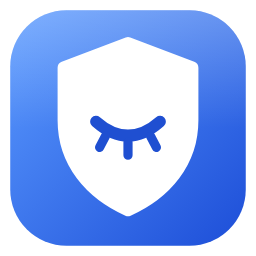

# Приватность Windows 11

**Отключает сбор данных Microsoft. Показывает, что о вас уже собрано.
Следит, чтобы обновления не вернули слежку обратно.**

[](https://github.com/N0deZ3r0/Win11Privacy/actions/workflows/build.yml)
[](https://github.com/N0deZ3r0/Win11Privacy/releases/latest)
[](https://github.com/microsoft/winget-pkgs/tree/master/manifests/n/N0deZ3r0/Win11Privacy)
[](LICENSE)


[English](README.md) · **Русский**

</div>

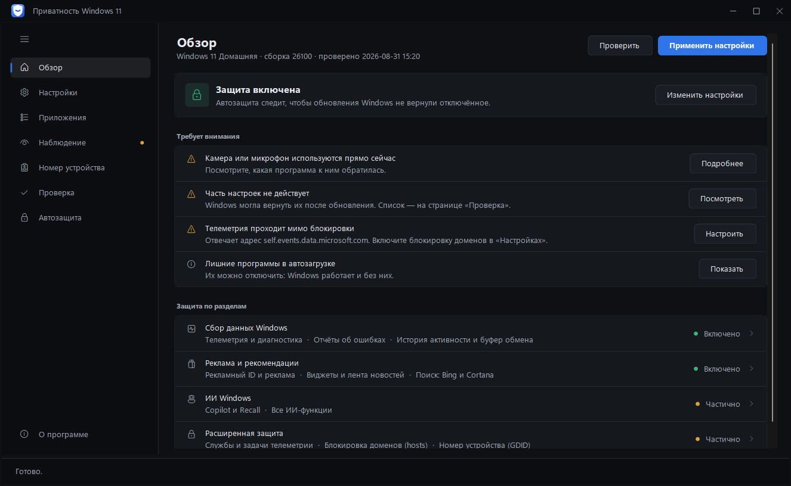

Восемь разделов: **Обзор**, **Настройки**, **Приложения** (и автозагрузка), **Наблюдение** (сбор данных, следы на компьютере, сеть, хронология), **Номер устройства**, **Проверка** (и журнал изменений), **Автозащита**, **О программе**.

---

## Чего нет у других

| | |
|---|---|
| **Следы на компьютере** | Кто и когда включал вашу камеру, микрофон и геолокацию — с длительностью и меткой «сейчас». Плюс цифровой след на диске: рекламный ID, история сетей Wi-Fi и флешек, история буфера обмена — с выборочным стиранием. |
| **Сбор данных изнутри** | Читает настоящие события, которые Windows собрала об этом компьютере, и показывает их сырое содержимое — тот самый JSON, что уходит в Microsoft. |
| **Что о вас узнали** | Из этих событий вытаскиваются готовые факты: названия установленных программ, модель и серийные номера железа, подключённые устройства, метки, по которым вас узнают. Не «1420 событий», а что именно из них следует. |
| **Хронология приватности** | События телеметрии по дням, обновления Windows, правки программы и возвраты автозащиты — на одной оси. Видно, как система отыгрывает настройки назад после очередного обновления. |
| **Проверка на деле** | Читает реальное состояние системы и считает индекс приватности, а не рисует галочки «сделано». |
| **Автозащита** | Крупные обновления Windows тихо возвращают часть настроек — автозащита проверяет систему по расписанию и возвращает сбитое. |
| **Слежение за датчиками** | Уведомление в тот момент, когда доступ к камере или микрофону впервые получила новая программа. |
| **Наблюдение за сетью** | Кто и куда реально отправляет данные — по журналу брандмауэра, отдельно разрешённые соединения и отклонённые попытки. |
| **Машина времени** | Снимки состояния настроек и сравнение: что и когда сбилось. |
| **Отзыв доступа на месте** | Увидели, что программа включала камеру, — и запрещаете ей доступ кнопкой в той же строке. |
| **Удаление предустановленного** | Список приложений, которые Windows ставит без спроса, с пометкой «можно убрать». Системные компоненты в перечень не попадают. |
| **Запрет выхода в сеть** | Вкладка «Сеть» показывает, кто и куда отправляет данные, — и кнопкой в той же строке программе закрывается выход в интернет. Правило создаётся в брандмауэре Windows и снимается тем же нажатием. |
| **Автозагрузка под контролем** | Что стартует вместе с Windows — с ответом «зачем это здесь»: обновлятор, агент телеметрии, помощник производителя. Гасится обратимо, тем же способом, что и в диспетчере задач, и попадает в общий откат. |
| **Настройка по пунктам** | Модуль раскрывается в список отдельных настроек: можно применить не всё, а выбранное. |
| **Блокировка адресов** | Брандмауэр режет сами IP сбора данных — через `hosts` телеметрия уходит в обход. |
| **Номер устройства, который виден сквозь VPN** | При входе в учётную запись Microsoft выдаёт компьютеру номер (GDID) и узнаёт его по нему при любом IP. У номера своя вкладка с тремя действиями. **Не передавать** отключает службы, которые его сообщают (CDPSvc, CDPUserSvc, DoSvc — последнюю через реестр, потому что Windows не даёт этого даже администратору), и закрывает серверы каталога устройств в `hosts`, включая IPv6; учётная запись Microsoft продолжает работать. **Сменить номер** стирает «личность» устройства вместе с учётными данными — Windows получает новый номер. **Запретить выдачу** ещё и закрывает сервер, который выдаёт номера, — нового не будет; это только для локальной учётной записи, при входе через учётную запись Microsoft программа отказывается. Отключение телеметрии тут не помогает: DiagTrack в этой цепочке не участвует. |
| **Предпросмотр изменений** | Кнопка «Что изменится» показывает список до применения: настройка, как сейчас, как станет. |
| **Возврат из копии** | Резервные копии реестра не просто складываются на диск — программа сама их находит и возвращает выбранную одним нажатием. |
| **Откат одной кнопкой** | Программа ведёт журнал изменений и возвращает каждый параметр в то значение, что было до неё, — не только реестр, но и службы (тип запуска, отложенный старт, работала ли), задачи планировщика и переменные среды. Задача, которую вы выключили сами, после отката останется выключенной, а чужие политики (например, корпоративные политики Chrome) не трогаются. Ручной импорт .reg не нужен. |
| **Видно, что изменено** | Страница «Изменения» показывает каждую правку: что было, что стало и где это лежит. Любую строку можно вернуть отдельно, не откатывая остальное. |
| **Считает честно** | Индекс не занижается тем, что от программы не зависит: настройки, которых нет на этой версии Windows, и параметры, которые Windows не отдаёт даже администратору, показаны отдельно и в знаменатель не идут. |
| **Переносимый режим** | Положите рядом с `Win11Privacy.exe` файл `portable.txt` — и программа будет хранить всё в папке рядом с собой, а не в системе. Для флешки и чужого компьютера. |
| **Убирает и за собой** | Всё, что программа накопила о вас у себя — историю датчиков, журнал, снимки — видно на «О программе» и стирается одной кнопкой. |
| **Сессии трассировки ETW** | Windows запускает сборщики телеметрии при загрузке, помимо службы DiagTrack — программа выключает и их. |
| **Доказательство результата** | Не «индекс 92 %», а что было до программы и что стало: сборщики, задачи, домены, события в сутки. |
| **Все разрешения приложений** | 34 категории — не только камера и микрофон, но и снимки экрана, уведомления, документы, весь диск, ключи доступа и ИИ-модели Windows. Видно и тех, кто разрешение имеет, но пока не пользовался. |
| **Разрешения — политикой, а не переключателями** | Контакты, календарь, звонки, почта, сведения учётной записи закрываются политикой: ни приложение, ни обновление Windows не включат их обратно. Сюда же входит возраст — новые Windows Age API без этого права приложению ничего не отдают. |
| **Фоновые обращения в сеть** | Метаданные устройств, шрифты по требованию, офлайн-карты, модели дисков и речи, Teredo — то, что Windows скачивает и отправляет сама. Пункты взяты из официального списка Microsoft, только безопасные. |
| **Облачная синхронизация и копия** | Найдено на чистой Windows 11 25H2: система сама выгружает в облако список ваших приложений, сети Wi-Fi, язык, тему, настройки пера и даже ваши ответы на вопросы о конфиденциальности. Отдельный раздел выключает это политикой и задачами. Сюда же — служба InventorySvc (опись программ для Microsoft) и сборщик «Usage and Quality Insights». Задачи, которые Windows не отдаёт администратору, программа отключает от имени системы. |
| **Скрытые каналы, найденные разбором системы** | Чистую Windows 11 записали два с лишним часа, запуская каждую задачу планировщика по очереди, и разобрали её системные файлы. Нашлось: Защитник раз в час забирает с сервера экспериментов около 130 настроек, включая уведомления Microsoft 365, — это закрывает отдельная политика; телеметрия 1DS (`mobile.events.data.microsoft.com` и региональные адреса) уходит от Защитника, оболочки и Copilot мимо службы DiagTrack — адреса добавлены в hosts; Магазин умеет ставить приложения по команде с сайта, а «Рекомендуемое устранение неполадок» применяет присланные Microsoft «исправления» — и то и другое выключается. |
| **Журналы Windows в цифровом следе** | Тысячи записей о том, какие программы запускались и к чему обращались, — видны в «Следах на компьютере» и стираются вместе с остальным следом. |
| **Один вопрос при первом запуске** | Вместо тринадцати разделов сразу — «базовая приватность», «строгая» или «сначала посмотреть, что обо мне собрано». Мастер ничего не применяет: он отмечает набор и показывает, что будет сделано. |
| **Долгую работу видно и можно остановить** | Кнопка «Прервать» в строке состояния. Чтение обрывается сразу, применение — после предупреждения; всё, что движок успел изменить, уже записано в журнал и возвращается на «Изменениях». Закрытие окна посреди работы тоже спрашивает, а не бросает движок в фоне. |
| **Журнал отката пишется по ходу дела** | Раньше он сохранялся один раз в самом конце: обрыв прогона оставлял изменения в системе, а вернуть их было нечем. Теперь журнал ложится на диск после каждого модуля и не реже, чем раз в десять правок. Если записать его не удалось (или другой запуск держит его дольше минуты), программа говорит об этом и больше ничего не меняет; перед применением она проверяет это заранее, пока ничего не тронуто. Повреждённый журнал откладывается рядом, а не затирается. |
| **Движок и данные лежат там, куда не пишут без прав администратора** | Скрипт запускается с полными правами, а журнал отката с полными правами записывается обратно в реестр — значит, ни то ни другое не должно быть доступно обычным программам. У `C:\ProgramData\Win11Privacy` явные права: писать могут только система и администраторы; всё, что туда заранее подложил не администратор, откладывается в сторону, а папка, заведённая кем-то другим, откладывается целиком. Перед каждым запуском файл движка сверяется по SHA-256 с тем, что вшито в exe, — и копия, которую запускает страж, тоже. |
| **Понятная ошибка вместо системного окна .NET** | Если программа спотыкается, она объясняет что случилось и пишет `crash.log`, который можно приложить к сообщению об ошибке. |
| **Автозащита приходит сразу после обновления** | Настройки сбивает обновление Windows, а расписание могло ждать до воскресенья. Теперь у автозащиты есть третий будильник — сама установка обновления: она проверяет систему через пять минут после неё. |
| **Программа одна** | Второй запуск показывает уже открытое окно вместо второго. Два окна с правами администратора применяли бы настройки одновременно и переписывали журнал отката друг друга. |
| **Видно, сколько проверок пройдено** | Проверка 283 настроек занимает до полуминуты и раньше молчала до самого конца. Теперь движок сообщает ход работы, а окно показывает «15 / 34» и название текущего раздела. |
| **Журнал выполнения сохраняется в файл** | Кнопка на странице «Журнал»: по этим журналам разбираются случаи «применилось не то», и присылать снимок экрана больше не нужно. |
| **Клавиатура и экранный диктор** | По разделам можно пройти табуляцией, Enter и пробел открывают выбранный, а нарисованные вручную элементы называют себя системе — раньше диктор читал пустоту. |

Ещё: готовые наборы «Базовый / Строгий / Максимум», телеметрия сторонних программ (Chrome, Edge, Office, VS Code, NVIDIA, PowerShell, Visual Studio),
слежка производителя ноутбука, блокировка через брандмауэр, стирание накопленного буфера телеметрии,
профили и тихий запуск из командной строки (профиль помнит и отдельные пункты внутри модулей),
проверка обновления по кнопке — сама программа в сеть не выходит, диагностика, светлая и тёмная темы.

---

## Переносимый режим

Обычно программа держит свои данные в `C:\ProgramData\Win11Privacy`, а размер
окна и язык — в `%LOCALAPPDATA%`. Если положить рядом с `Win11Privacy.exe` файл
**`portable.txt`** (или один раз запустить `Win11Privacy.exe --portable`), всё
переедет в папку `Win11Privacy-Data` рядом с самой программой: журнал изменений,
история датчиков, снимки, резервные копии реестра и настройки окна. На чужом
компьютере после себя не остаётся ничего, кроме самих изменений в системе —
которые по-прежнему можно откатить. Кое-что всегда лежит в
`C:\ProgramData\Win11Privacy`, потому что рядом с exe это могла бы подменить любая
ваша программа: папка, куда распаковывается движок, ключ, которым подписан журнал
изменений, и копия движка для автозащиты. Сама автозащита (страж и наблюдение — их
задачи сами запускаются с правами администратора) в переносимом режиме работает,
только если программа лежит в папке, куда обычные программы писать не могут, —
например, в Program Files на диске NTFS; папка данных тогда закрыта для всех, кроме
администраторов.

---

## Windows 10

Программа работает и на Windows 10, но 12 настроек из набора относятся к тому,
чего там нет вовсе: Copilot, Recall, Click to Do, виджеты. Они помечены
минимальной версией Windows, не применяются и **не считаются в индексе** —
на «Проверке» видно плитку «Нет на этой Windows». Политики Edge, Блокнота и
Paint при этом работают на обеих версиях и применяются как обычно.

---

## Язык

Интерфейс полностью на русском и английском, включая названия всех 283 настроек
и HTML-отчёт.
По умолчанию программа при каждом запуске берёт язык интерфейса Windows: русский,
если Windows на русском, иначе английский. Кнопка на странице «О программе»
переключает «как в Windows» → русский → английский, чтобы закрепить один язык.

---

## Скачать и запустить

**Через winget:**

```
winget install N0deZ3r0.Win11Privacy
```

Затем запускайте командой `Win11Privacy` в новом окне терминала. Или скачайте вручную:

1. Возьмите `Win11Privacy.exe` из [релизов](https://github.com/N0deZ3r0/Win11Privacy/releases/latest).
2. Правый клик по файлу → **Свойства** → внизу галочка **«Разблокировать»** → ОК.
   Так убирается предупреждение SmartScreen — оно появляется у любого неподписанного приложения из интернета.
3. Запустите. Программа попросит права администратора: без них системные настройки не меняются.

Устанавливать ничего не нужно — приложение работает на встроенном в Windows .NET Framework 4.8,
а движок вшит внутрь exe.

> **Совет:** первым делом нажмите **«Проверить»** — увидите текущее состояние, ничего при этом не меняя.
> Резервная копия реестра и точка восстановления создаются автоматически перед применением.

---

## Как это выглядит

| Настройки — профиль и разделы | Наблюдение → Следы на компьютере — кто включал камеру и микрофон |
|---|---|
| 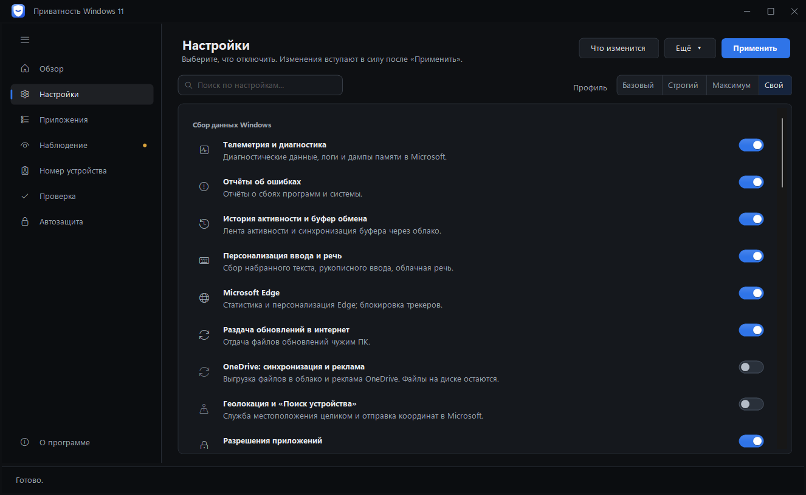 | 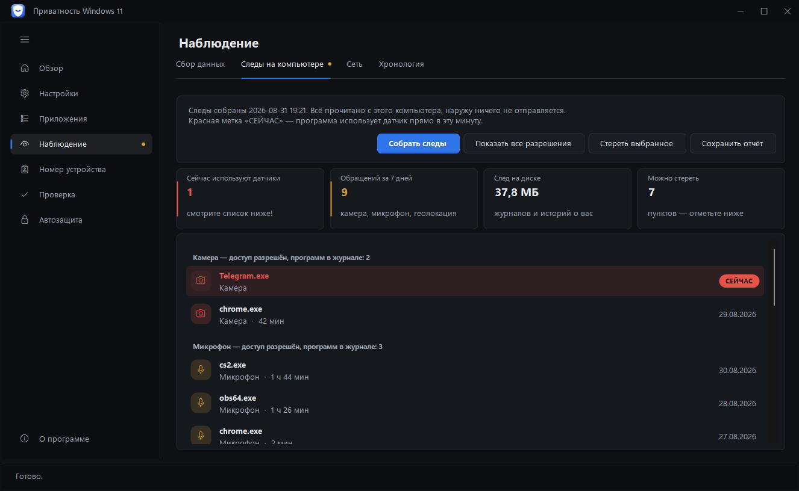 |

| Наблюдение → Сбор данных — что Windows узнала о компьютере | Номер устройства — тот, что виден сквозь VPN |
|---|---|
| 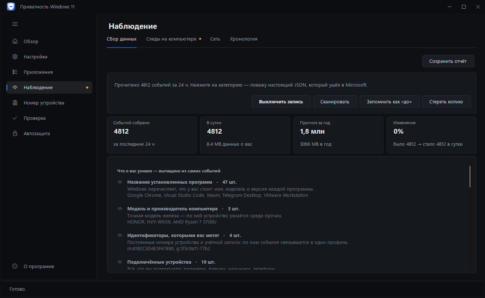 | 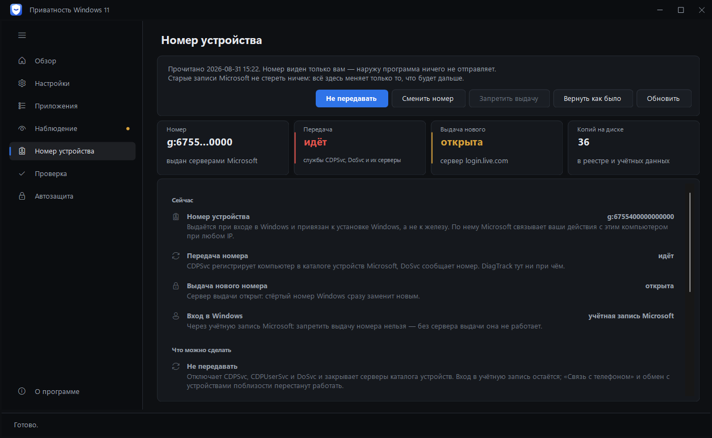 |

| Проверка — что действует, а что нет | Проверка → Изменения — что поменяли и как вернуть |
|---|---|
| 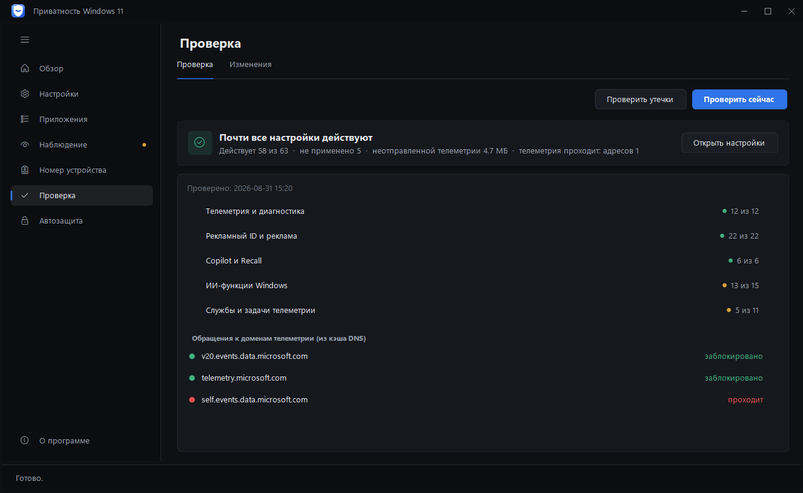 | 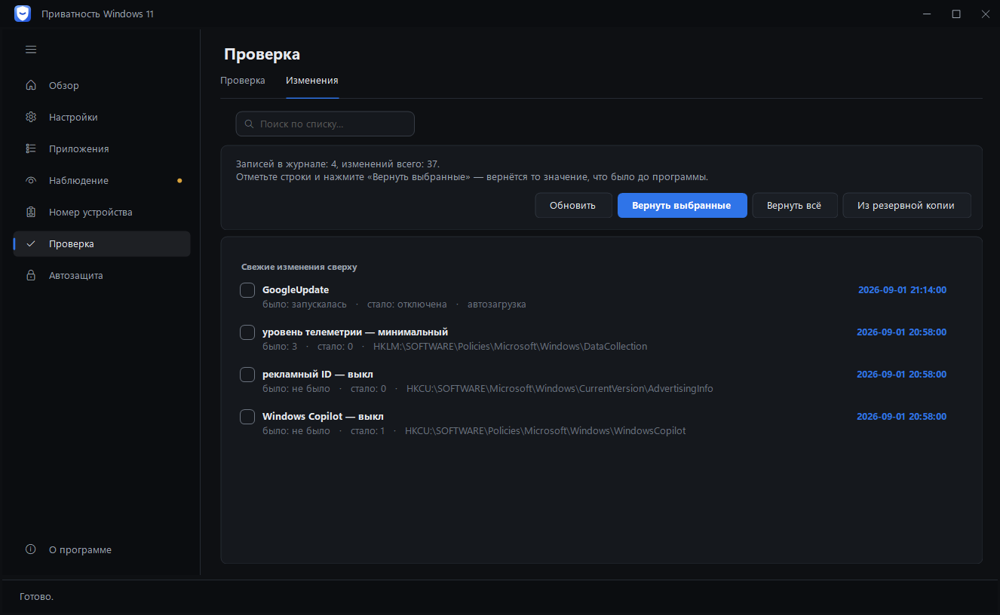 |

| Приложения — удаление предустановленного | Приложения → Автозагрузка — что стартует вместе с Windows |
|---|---|
| 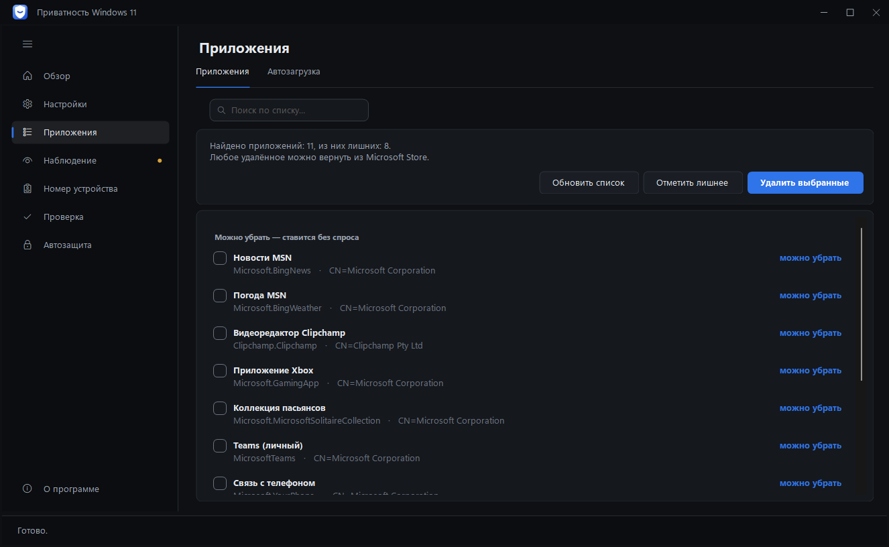 | 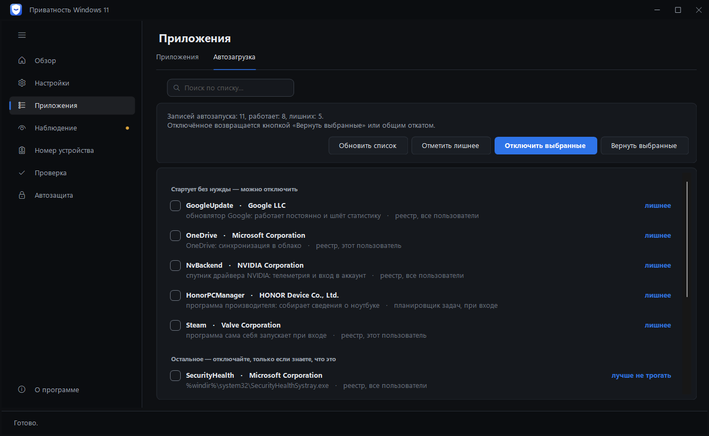 |

| Наблюдение → Сеть — кто отправляет и кому закрыт выход | Наблюдение → Хронология — телеметрия по дням и обновления Windows |
|---|---|
| 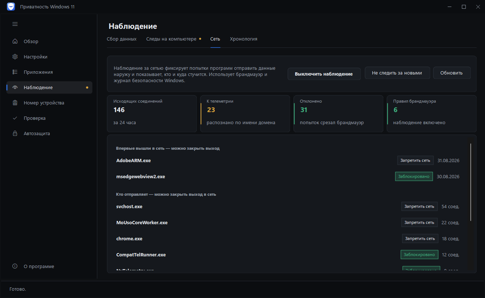 | 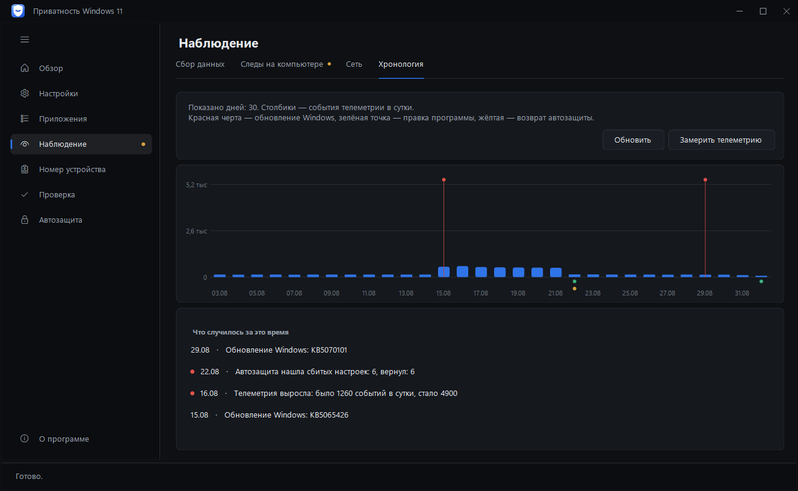 |

---

## Как собрать

Двойной клик по **`build.cmd`**. Через пару секунд рядом появится `Win11Privacy.exe`.
Если установлен Python 3, `build.cmd` сначала соберёт движок из частей в
`engine/`; без Python возьмёт готовый `Win11-Privacy-Engine.ps1` — в репозитории
он всегда собран.

Если хочется вручную (после правок в `engine/` — сначала `python tools/build_engine.py`):

```
%WINDIR%\Microsoft.NET\Framework64\v4.0.30319\csc.exe /target:winexe /out:Win11Privacy.exe ^
  /reference:System.dll /reference:System.Core.dll /reference:System.Drawing.dll /reference:System.Windows.Forms.dll ^
  /win32res:app.res ^
  /resource:Win11-Privacy-Engine.ps1,engine.ps1 /resource:app.ico,app.ico /resource:app.png,app.png ^
  *.cs
```

---

## Из чего состоит

| Файл | Что внутри |
|---|---|
| **Win11-Privacy-Engine.ps1** | Движок. Вся работа с системой: реестр, службы, задачи планировщика, hosts, брандмауэр, рентген телеметрии, досье (датчики и цифровой след), страж, снимки состояния, чистка. Вшивается в exe как ресурс `engine.ps1`, а перед запуском кладётся в `C:\ProgramData\Win11Privacy\bin` — папку, куда без прав администратора не пишут. Может работать и сам по себе. Собирается из частей в `engine/` — правьте их, а не этот файл. |
| **engine/NN-раздел.ps1** | Исходники движка по разделам: параметры, общие функции, папка данных, журнал отмены, определения настроек, применение и проверка, номер устройства, рентген, досье, страж, откат и так далее. `python tools/build_engine.py` склеивает их по порядку номеров в один `Win11-Privacy-Engine.ps1`, `--check` сверяет собранное с частями (так проверяет сборка на GitHub), `--where N` подскажет, в какой части строка N из сообщения PowerShell об ошибке. Функцию нужно описывать в части с меньшим номером, чем место, откуда её вызывают при запуске: движок выполняется сверху вниз. Каждая часть — законченный кусок: функция не может начаться в одной части и закончиться в другой (сборка на GitHub разбирает каждую часть отдельно). |
| **MainForm.cs** | Окно: сборка каркаса и страниц, определение системы при запуске, состояние окна между запусками, значок и заголовок. |
| **Navigation.cs** | Разделы и вкладки, боковая панель (сворачивание, анимация), переходы между страницами. |
| **Page*.cs** | По файлу на страницу: «Обзор», «Настройки», «Приложения» и «Автозагрузка», «Сбор данных», «Следы на компьютере», «Сеть», «Хронология», «Номер устройства», «Проверка», «Изменения», «Автозащита», «О программе», «Журнал». |
| **ListPage.cs** | Общий каркас страниц-списков (поиск, карточка, кнопки) и помощники для них. |
| **EngineRunner.cs** | Запуск движка: потоковый вывод, ответы `###JSON###`, занятость и кнопка «Прервать». |
| **Program.cs** | Точка входа, режим командной строки и тестовые прогоны интерфейса. |
| **Actions.cs** | Что делает каждая кнопка: применение, проверка, монитор, страж. |
| **Report.cs** | HTML-отчёт «до и после». |
| **Engine.cs** | Распаковка движка: папка с правами только для администратора и сверка файла по SHA-256 с тем, что вшито в exe. |
| **Crash.cs** | Перехват необработанных ошибок: понятное окно вместо системного и запись в `crash.log`. |
| **AppInfo.cs** | Версия программы и проверка обновления на GitHub — только по кнопке. |
| **Welcome.cs** | Окно первого запуска: один вопрос вместо тринадцати разделов сразу. |
| **Mocks.cs** | Тестовые данные для снимков интерфейса, целиком под `#if UITEST`. |
| **SingleInstance.cs** | Одна копия программы: второй запуск показывает уже открытое окно. |
| **SelfTest.cs** | Проверки чистых функций интерфейса — сравнение версий, разбор ответов движка, «эта команда меняет систему или только читает». Отдельная сборка под `#if SELFTEST`. |
| **Theme.cs** | Тема (цвета, шрифты), тёмные полосы прокрутки, рамка фокуса только с клавиатуры, плавные переходы, тёмное меню. |
| **Frame.cs** | Каркас окна: заголовок, боковая панель, пункты навигации и скользящая подсветка. |
| **Controls.cs** | Базовые элементы: карточки, кнопки, переключатели, вкладки, поиск, заголовки разделов, пустое состояние. |
| **Rows.cs** | Строки списков и сами списки: настройки, проверка, досье, сеть, обзор. |
| **Charts.cs** | Графики и плитки: кольцо индекса, кольцевая диаграмма, датчики, хронология, сетка плиток. |
| **ListDialog.cs** | Окно со списком и галочками — «Что изменится» и похожие вопросы. |
| **Lang.cs** | Английский перевод интерфейса. Собирается из `lang-en*.txt` командой `python tools/gen_lang.py` — правьте словари, а не сам Lang.cs. `python tools/check_lang.py` покажет строки, для которых перевода ещё нет. |
| **Json.cs** | Разбор JSON без внешних библиотек — движок отвечает строками `###JSON### {...}`. |
| **app.manifest** | Требование прав администратора, поддержка масштабирования экрана. |
| **app.res** | Готовый ресурс Win32: манифест + иконка (10 размеров, 16–256) + версия. Пересобирать не нужно. |
| **app.ico / app.png** | Иконка приложения. Сменить её: `python tools/set_icon.py logo-16.png ... logo-256.png` — соберёт app.ico и положит те же картинки в app.res. |
| **tests/engine-tests.ps1** | Проверки поведения движка: их же гоняет сборка на GitHub. Только чтение. |
| **tests/engine.Tests.ps1** | Pester-проверки записи в реестр и её сверки, набора адресов брандмауэра, подмены hosts одним действием, отката служб и ошибок доступа к реестру. Работают со встроенным Pester 3.4 и с Pester 5; их гоняет сборка на GitHub. |
| **tests/roundtrip.ps1** | Применить, проверить и откатить по-настоящему, затем сверить каждое значение с исходным. Меняет систему, поэтому требует ключа `-Confirmed`; в сборке выполняется на одноразовой машине. |
| **CHANGELOG.md** | Что изменилось в каждой версии. Отсюда же берётся описание релиза на GitHub. |
| **docs/security-model.md** | Модель безопасности и гарантии отката: границы доверия, подписанный журнал, запись журнала раньше изменения, что переживает обрыв, как сверяется откат, известные пределы. |
| **tools/build_engine.py** | Собирает `Win11-Privacy-Engine.ps1` из частей в `engine/`. `--check` сверяет, сборка на этом настаивает; `--where N` найдёт строку собранного файла в её части. Если собранный файл правили руками, остановится, а не затрёт правки (`--force` — затереть всё же). |
| **tools/release_notes.py** | Собирает описание релиза: раздел версии из `CHANGELOG.md`, как запустить и какие файлы приложены. |
| **tools/make_winget.py** | Собирает манифест для каталога winget по версии и контрольной сумме релиза. |
| **tools/set_version.py** | Прописывает версию программы в `app.res` — ту, что Windows показывает в свойствах файла. `--check` сверяет, сборка на этом настаивает. |
| **tools/submit_winget.py** | Отправляет манифест очередной версии в каталог winget: создаёт ветку в форке, кладёт файлы и открывает pull request. Каталог не клонируется — он весит гигабайты. |
| **check-engine.cmd** | Самопроверка движка. Только чтение, ничего не меняет. |

---

## Как программа устроена

Интерфейс **ничего не делает сам**. Он собирает список выбранных модулей и
запускает движок:

```
powershell.exe -File engine.ps1 -Modules telemetry,ads,cleanup -BackupRoot "C:\...\Desktop"
```

Движок печатает ход работы построчно (интерфейс раскрашивает: `[+]` зелёным,
`[!]` красным) и в конце может выдать структурированный ответ строкой
`###JSON### {...}` — его разбирает `Json.cs` и рисует на страницах.

Благодаря этому движок полностью проверяем отдельно от интерфейса.

### Команды движка

| Команда | Что делает |
|---|---|
| `-Modules a,b,c` | применить выбранные модули |
| `-DryRun` | показать что было бы сделано, ничего не меняя |
| `-Detect` | определить систему, редакцию, установленные программы, слежку производителя |
| `-Audit` | прочитать реальное состояние всех настроек, вернуть индекс |
| `-XrayEnable` / `-XrayScan` / `-XrayWipe` | рентген телеметрии |
| `-Spy` | досье: кто и когда включал камеру, микрофон, геолокацию |
| `-Footprint` | досье: цифровой след на диске (рекламный ID, сети, флешки, истории) |
| `-FootprintWipe -WipeItems a,b` | стереть выбранные элементы следа |
| `-SensorSet -SensorKey k -SensorValue Deny` | запретить программе доступ к камере, микрофону или геолокации |
| `-Proof` / `-ProofSave` | доказательство результата: снимок «до» и сравнение с текущим |
| `-ListDefs` | список отдельных настроек внутри модулей |
| `-SkipItems a#1,b#2` | применить модуль, кроме указанных пунктов |
| `-ListApps` / `-RemoveApps -AppItems a,b` | предустановленные приложения: список и удаление |
| `-ListStartup` | автозагрузка: что стартует вместе с Windows |
| `-ChangeLog` / `-RestoreItems -ChangeItems a,b` | журнал изменений и возврат отдельных записей |
| `-DataInfo` / `-PurgeData` | что программа хранит о вас у себя и удаление этого |
| `-DataRoot "C:\...\Win11Privacy-Data"` | держать данные в указанной папке (переносимый режим) |
| `-Timeline -TimelineDays 30` | хронология: телеметрия по дням, обновления Windows, правки и возвраты |
| `-ListBackups` / `-RestoreBackup -BackupPath ...` | резервные копии реестра: список и возврат |
| `-CleanJunk` | убрать параметры, записанные версиями до 1.6 под числовыми именами |
| `-StartupSet -StartupItems a,b -StartupValue Off` | погасить или вернуть записи автозапуска |
| `-InstallSensorGuard` / `-RemoveSensorGuard` | слежение за датчиками: каждые 30 минут сверка журнала, уведомление о новой программе |
| `-SensorGuard` | одна проверка слежения (её запускает планировщик) |
| `-Monitor` / `-EnableMonitor` | статистика исходящих соединений |
| `-BlockApp -AppPath "C:\...\app.exe"` | запретить программе выход в сеть (`-UnblockApp` — вернуть) |
| `-Audit -WithProof` | проверка и доказательство результата одним прогоном |
| `-InstallGuard` / `-GuardNow` | страж, возвращающий сбитые настройки |
| `-Snapshot` / `-SnapshotDiff` | машина времени |
| `-InstallWatcher` / `-RemoveWatcher` | живые уведомления о перехвате |
| `-SelfTest` | самопроверка движка: та же «Диагностика», что и в окне |
| `-RestoreAll` | вернуть все записи журнала, ничего больше не трогая |
| `-PurgeBuffer` | стереть неотправленную телеметрию |
| `-XrayStatus` / `-XrayDisable` / `-XrayBaseline` | состояние записи, выключение, замер «до» |
| `-Revert` | откат всего |

Ключи-уточнения: `-NoBackup` и `-NoRestorePoint` (не делать копию и точку
восстановления), `-GuardDaily` (страж каждый день вместо раза в неделю),
`-AllUsers` (удалять приложения у всех пользователей), `-SpyAll` (показать и
неиспользованные разрешения), `-MonitorHours`, `-XrayHours`, `-XrayMax`,
`-TimelineDays` (за какой срок и сколько событий брать).

### Как добавить новую настройку

Одна строка в движке — в `engine/08-definitions.ps1`, рядом с остальными, —
затем `python tools/build_engine.py`:

```powershell
Def 'telemetry' 'reg' 'HKLM:\SOFTWARE\Policies\...' 'ИмяПараметра' 0 'DWord' 'человеческое описание'
```

`Def` описывает **что должно быть**, а не как это сделать. Из одного описания
работают сразу: применение, проверка, страж и снимки состояния. Поддерживаемые
типы: `reg`, `regif` (только если ключ уже есть), `regpol` (политика, которую
Windows может не отдать даже администратору — тогда это не ошибка), `svc`,
`svcopt`, `task`, `taskglob`, `env`, `vscode`, `firefox`, `hosts`, `fwsvc`,
`fwapp`.

Чтобы новый модуль появился в интерфейсе — добавьте строку в `BuildModules()`
в `MainForm.cs`.

---

## Проверка без сборки

Откат проверяется отдельно — по-настоящему, с применением и возвратом:

```
powershell -ExecutionPolicy Bypass -File tests\roundtrip.ps1 -Confirmed
```

Тест меняет настройки компьютера, поэтому без ключа `-Confirmed` он не
запускается. Он применяет модули, убеждается, что проверка это видит,
откатывает и сверяет **каждое** значение с тем, что было до начала: сравнивать
только итоговые счётчики мало — взаимная компенсация ошибок прошла бы
незамеченной.

**`check-engine.cmd`** запускает движок в режиме только чтения и складывает
рядом четыре файла с результатами: определение системы, проверка настроек,
статус рентгена и тестовый прогон. Ничего в системе не меняется.

---

## Что можно посмотреть в отладке

Интерфейс собирается с флагом `UITEST` — тогда окно открывается с тестовыми
данными и само закрывается через 13 секунд:

```
csc ... /define:UITEST ...
```

Переменные окружения: `WIN11_TEST_PAGE` (какую страницу открыть),
`WIN11_TEST_MOCK=1` (подставить тестовые данные), `WIN11_TEST_EN=1`
(английский интерфейс), `WIN11_TEST_SHOT=путь.png` (снять окно и выйти),
`WIN11_TEST_WELCOME=1` (показать окно первого запуска), `WIN11_TEST_UPDATE=1`
(нажать «Проверить обновление»), `WIN11_TEST_DUMP=1` (напечатать дерево
элементов с пометками «ВЫЛЕЗ» и «ОБРЕЗАНО»), `WIN11_TEST_SIDE=папка` (свернуть
и развернуть боковую панель, напечатать время каждого кадра строками `SIDEFRAME`
и сохранить кадры в папку; `-` — только время), `WIN11_TEST_README=1` (вместе с
`WIN11_TEST_MOCK=1`: перед снимком вернуть тестовые данные и строку состояния
«Готово» — так сняты картинки в `docs/`). Ещё есть флаги сборки `BIGFONT` —
имитация экрана со 150 % масштабом, и `LIGHTTEST` — светлая тема.

Проверки чистых функций интерфейса собираются отдельным exe:

```
csc /define:SELFTEST /main:Win11Privacy.SelfTest ... *.cs
```

---

## Если вы пользовались версиями 1.1–1.5

В них была ошибка: счётчик внутри функции `Def` затирал имя параметра реестра
(в PowerShell `$n` и `$N` — одна переменная). Из-за этого настройки записывались
под числовыми именами — `0`, `1`, `2` вместо `AllowTelemetry` — и **ничего не
меняли**, а проверка показывала их применёнными, потому что читала то же
неверное имя.

Начиная с 1.6 имена восстановлены. Программа сама находит оставшийся мусор
(кнопка **«Убрать мусор»** на странице «Проверка» или `-CleanJunk`) и удаляет
только те числовые параметры, которые совпадают и по номеру, и по значению.
После обновления стоит один раз нажать «Проверить», а затем «Применить».

---

## Честно о пределах

Полностью прекратить обмен данными с Microsoft на Windows нельзя: остаются
проверка обновлений, активация лицензии и проверка сертификатов. На редакциях
Home и Pro минимальный уровень телеметрии система трактует как «Обязательные
данные» — это ограничение редакции, а не программы.

Программа не подписана сертификатом, поэтому Windows покажет предупреждение
SmartScreen при первом запуске скачанного файла: правый клик по файлу →
Свойства → галочка «Разблокировать». Запрос прав администратора остаётся —
он нужен, потому что программа меняет системные настройки.

---

## Сборка и релизы

Локально: двойной клик по **build.cmd** — рядом появится Win11Privacy.exe.

В репозитории настроена автосборка (GitHub Actions):

- на каждый коммит в main и каждый pull request — движок сверяется со сборкой
  из частей в `engine/`, проверяется его синтаксис,
  сверяются версии движка, интерфейса и ресурса версии, прогоняются проверки
  его поведения и проверки чистых функций интерфейса,
  сверяется перевод, **настройки применяются и откатываются на живой одноразовой
  машине, а каждое значение сверяется с тем, что было до**, все страницы
  интерфейса и окно первого запуска открываются на тестовых данных по-русски и
  по-английски, собирается exe и проверяется, что движок вшит внутрь и совпадает
  с исходником, а манифест запрашивает права администратора;
- на тег вида **v1.0.0** — сверяется, что тег совпадает с версией внутри
  программы, собранный exe выкладывается в релиз вместе с контрольными суммами
  и манифестом для каталога winget, а сам манифест отправляется в каталог
  отдельным pull request.

Описание релиза берётся из **`CHANGELOG.md`**: сборка по тегу `v1.11.0` ищет там
раздел `## 1.11.0`, добавляет к нему «как запустить» и список файлов. Раздела нет —
сборка падает ещё до компиляции, и релиз без описания не выходит. Новое пишется в
раздел «Не выпущено», перед выпуском он переименовывается в номер версии.
Посмотреть, как будет выглядеть описание:

```
python tools/release_notes.py --version unreleased
```

Отправка в каталог включается секретом репозитория **`WINGET_TOKEN`** — личный
токен с правом `public_repo`: встроенный токен сборки в чужой репозиторий писать
не может. Без секрета шаг молча пропускается, и манифест можно отправить рукой:

```
python tools/submit_winget.py
```

Согласие участника (CLA) подписывается один раз, форк каталога создаётся сам.

Выпустить новую версию:

1. Поднимите номер в двух местах — `AppInfo.cs` (`Version`) и движке
   (`$script:EngineVersion` в `engine/01-constants.ps1`), — а затем соберите
   движок и пропишите номер в ресурс версии, тот самый, что Windows показывает
   в свойствах файла:

   ```bash
   python tools/build_engine.py
   ```

   ```bash
   python tools/set_version.py
   ```

2. Закоммитьте изменения в `main`. Сборка проверит движок и интерфейс, сверит
   перевод и убедится, что все три версии совпадают между собой.
3. Поставьте тег с той же версией и отправьте его:

   ```bash
   git tag -a v1.9.3 -m "коротко о том, что изменилось"
   git push origin v1.9.3
   ```

4. Дальше всё само: сборка сверит тег с версией внутри программы, применит и
   откатит настройки на одноразовой машине, создаст релиз с `Win11Privacy.exe`,
   `Win11-Privacy-Engine.ps1`, `SHA256SUMS.txt` и `winget-manifest.zip`, а
   затем отправит манифест в каталог winget отдельным pull request.

Если тег и версия внутри программы разойдутся, сборка остановится — релиз с
чужим номером не выйдет.
